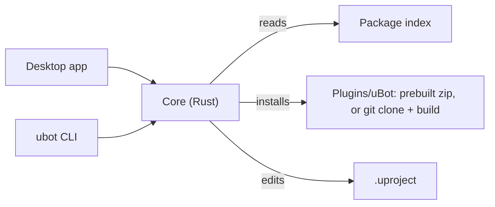

<p align="center">
  <picture>
    <source media="(prefers-color-scheme: dark)" srcset="docs/brand/ubot-mark-light.svg">
    <source media="(prefers-color-scheme: light)" srcset="docs/brand/ubot-mark-dark.svg">
    
  </picture>
</p>
<h1 align="center">uBot Manager</h1>
<p align="center"><b>Install, update and build uBot packages in your Unreal Engine 5.5 projects.</b></p>
<p align="center">
  <a href="https://github.com/AstreoX/uBotManager/releases"></a>
  <a href="LICENSE"></a>
  
</p>
<p align="center">
  <a href="https://astreox.github.io/uBotDocs/manager/">Documentation</a> ·
  <a href="https://github.com/AstreoX/uBotManager/releases">Releases</a> ·
  <a href="https://github.com/users/AstreoX/projects/2">Roadmap</a> ·
  <a href="https://github.com/AstreoX/uBotManager/issues">Issues</a>
</p>

**English** | [简体中文](README.zh-CN.md)

## What it is

uBot Manager is a Windows desktop app that installs, updates, enables, disables and removes uBot packages in an Unreal Engine 5.5 project. It resolves dependencies, shows you the plan, and only then downloads a prebuilt package or clones and builds one from source. The `ubot` command line runs the same core for scripts and CI.

- **Review before anything runs.** Changes are queued and shown as steps; nothing is applied until you confirm.
- **Prebuilt first.** Downloads a checked prebuilt package when one fits your engine; otherwise clones the tag and builds.
- **Dependencies included.** Required packages and engine plugins are installed or enabled together.
- **Recipes.** Apply a ready-made set, such as ROS 2 Sensors, in one pass.
- **Problems with quick fixes.** Missing or mismatched dependencies are listed with fixes you can queue.
- **Graph, task log, themes.** A dependency graph, a log per task, English and Simplified Chinese, dark and light.

## Install

1. Download `uBot-Manager_<version>_x64-setup.exe` from [Releases](https://github.com/AstreoX/uBotManager/releases) and run it. It installs for the current user without administrator rights, and you can choose the folder.
2. The installer is not code-signed, so Windows SmartScreen may show an "unknown publisher" prompt: choose *More info > Run anyway*.

Alternatives:

- **`ubot` command line.** It is not in the installer. Build it with `cargo build --release -p ubot-cli` (Rust stable, MSVC); the result is `target\release\ubot.exe`.
- **From source.** Build the desktop app yourself, see [docs/DEVELOPMENT.md](docs/DEVELOPMENT.md).
- **Without the Manager.** Clone the plugins by hand, see the [install guide](https://astreox.github.io/uBotDocs/start/install/).

Requires Windows 10 or 11 (WebView2, built into Windows 11) and Unreal Engine 5.5. Git is needed to install from source and Visual Studio 2022 (C++ tools) to compile; installing prebuilt packages needs neither.

## Quick start

1. Start uBot Manager, click `Open…` and choose your `.uproject`.
2. Click `Recipes`, select `ROS 2 Sensors`, click `Review Changes…`, then `Apply`.
3. Open the project in UE 5.5: `Window > uBot` lists the loaded packages.

The same from a shell, where `plan` changes nothing:

```powershell
ubot --project .\MyRobotSim.uproject status
ubot --project .\MyRobotSim.uproject plan install:UBotROS
ubot --project .\MyRobotSim.uproject apply install:UBotROS --yes
```

Desktop app and command line share one core:



## Documentation

The documentation site is written in Simplified Chinese.

| I want to ... | Go to |
| --- | --- |
| Install uBot packages in a project | [Install uBot](https://astreox.github.io/uBotDocs/start/install/) |
| Learn the views, tasks and problems | [Interface tour](https://astreox.github.io/uBotDocs/manager/) |
| Install, update or remove packages | [Install, update, remove](https://astreox.github.io/uBotDocs/manager/packages/) |
| Apply a set of packages at once | [Recipes](https://astreox.github.io/uBotDocs/manager/recipes/) |
| Change settings and index sources | [Settings](https://astreox.github.io/uBotDocs/manager/settings/) |
| Script it from a shell or CI | [`ubot` command line](https://astreox.github.io/uBotDocs/manager/cli/) |
| Write my own uBot package | [Package authoring](https://astreox.github.io/uBotDocs/develop/package-authoring/) |
| Build or release the Manager | [DEVELOPMENT](docs/DEVELOPMENT.md) · [RELEASING](docs/RELEASING.md) · [INTERNALS](docs/INTERNALS.md) (Chinese) |

## uBot series

| Repository | What it is |
| --- | --- |
| [uBotCore](https://github.com/AstreoX/uBotCore) | Simulation clock, frame header, shared interfaces, package management |
| [uBotSensor](https://github.com/AstreoX/uBotSensor) | Pose, IMU, odometry, 2D/3D lidar, RGB and depth cameras |
| [uBotROS](https://github.com/AstreoX/uBotROS) | ROS 2 over a TCP bridge: sensors, TF, /clock, cmd_vel |
| [uBotAerial](https://github.com/AstreoX/uBotAerial) | Multirotor drones: simplified flight, rigid-body dynamics, wind |
| **[uBotManager](https://github.com/AstreoX/uBotManager)** | **Desktop app and CLI to install, update and build uBot packages** |
| [uBotDocs](https://github.com/AstreoX/uBotDocs) | Documentation site: https://astreox.github.io/uBotDocs/ |

## Development

- Needs Rust (stable, MSVC) and Node.js 22.12 or later. In `app/` run `npm ci` and `npm run tauri build -- --no-bundle`; at the root run `cargo build --release -p ubot-cli`.
- Test with `cargo test --workspace` and, in `app/`, `npm test`.
- Details are in [docs/DEVELOPMENT.md](docs/DEVELOPMENT.md); the release process is in [docs/RELEASING.md](docs/RELEASING.md).
- Report bugs and ideas in [Issues](https://github.com/AstreoX/uBotManager/issues).

## License

Copyright 2026 AstreoX. Released under the [Apache License 2.0](LICENSE): use, modify and redistribute freely, including commercially. Keep the [LICENSE](LICENSE) and [NOTICE](NOTICE) files when redistributing, and mark the files you changed.

### Code signing policy

Release installers are built from this repository's source by the [`Release` workflow](.github/workflows/release.yml) and then signed. Signing is being applied for with the SignPath Foundation; installers released before it takes effect are not signed.

Free code signing provided by [SignPath.io](https://about.signpath.io/), certificate by [SignPath Foundation](https://signpath.org/).

- Committers and reviewers: [AstreoX](https://github.com/AstreoX)
- Approvers: [AstreoX](https://github.com/AstreoX)

Privacy policy: uBot Manager does not collect or send personal data, usage data or telemetry. It connects to other systems only to:

- download the package index, by default from `raw.githubusercontent.com`: at startup (can be turned off with *Settings > Package Index > Sync index on startup*) and when you click the refresh button;
- download prebuilt packages or clone package repositories from the addresses listed in the index (by default `github.com`) when you install or update packages.

Requests to GitHub are covered by the [GitHub General Privacy Statement](https://docs.github.com/site-policy/privacy-policies/github-general-privacy-statement).
