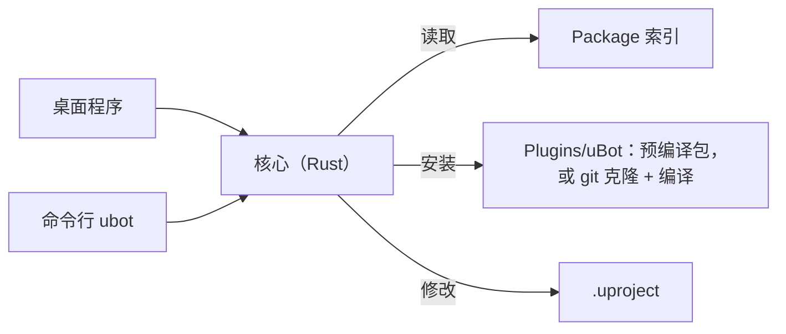

<p align="center">
  <picture>
    <source media="(prefers-color-scheme: dark)" srcset="docs/brand/ubot-mark-light.svg">
    <source media="(prefers-color-scheme: light)" srcset="docs/brand/ubot-mark-dark.svg">
    
  </picture>
</p>
<h1 align="center">uBot Manager</h1>
<p align="center"><b>在 Unreal Engine 5.5 工程里安装、更新、构建 uBot Package。</b></p>
<p align="center">
  <a href="https://github.com/AstreoX/uBotManager/releases"></a>
  <a href="LICENSE"></a>
  
</p>
<p align="center">
  <a href="https://astreox.github.io/uBotDocs/manager/">文档</a> ·
  <a href="https://github.com/AstreoX/uBotManager/releases">发布版本</a> ·
  <a href="https://github.com/users/AstreoX/projects/2">路线图</a> ·
  <a href="https://github.com/AstreoX/uBotManager/issues">问题反馈</a>
</p>

[English](README.md) | **简体中文**

## 简介

uBot Manager 是 Windows 桌面程序，用于在 Unreal Engine 5.5 工程中安装、更新、启用、禁用和卸载 uBot Package。它自动处理依赖并生成计划，确认后下载预编译包，或克隆源码并编译。命令行 `ubot` 与桌面程序共用同一个核心，面向脚本和 CI。

- **先计划，后执行。** 所有更改先以步骤列出，确认后才执行。
- **预编译或源码。** 引擎为启动器版本且索引中有对应的预编译包时，下载并校验后安装；否则克隆对应标签并编译。
- **依赖一并处理。** 所需的 Package 和引擎插件一起安装或启用。
- **Recipe。** 按预设组合批量安装 Package，例如 ROS 2 传感器。
- **问题与快速修复。** 列出依赖缺失、版本不符等问题，并提供快速修复。
- **依赖图、任务日志、主题。** 提供依赖图和任务日志，界面支持简体中文与英文、深色与浅色主题。

## 安装

1. 从 [Releases](https://github.com/AstreoX/uBotManager/releases) 下载 `uBot-Manager_<版本>_x64-setup.exe` 并运行。安装包按当前用户安装，无需管理员权限，安装目录可选。
2. 安装包没有代码签名，SmartScreen 会提示「未知发布者」，选择「更多信息 > 仍要运行」。

其他方式：

- **命令行 `ubot`。** 不含在安装包中，用 `cargo build --release -p ubot-cli` 构建（Rust stable，MSVC），产物为 `target\release\ubot.exe`。
- **从源码构建。** 构建桌面程序，参见 [docs/DEVELOPMENT.md](docs/DEVELOPMENT.md)。
- **不使用 Manager。** 手动安装插件，参见[安装指南](https://astreox.github.io/uBotDocs/start/install/)。

运行要求：Windows 10 或 11（WebView2 运行库，Windows 11 已内置）和 Unreal Engine 5.5。从源码安装另需 git 和 Visual Studio 2022（含 C++ 工具链）。

## 快速开始

1. 启动 uBot Manager，单击 `打开…`，选择工程的 `.uproject` 文件。
2. 单击 `Recipe`，选择 `ROS 2 传感器`，再依次单击 `查看更改…` 和 `应用`。
3. 用 UE 5.5 打开工程，在 `Window > uBot` 中查看已加载的 Package。

命令行的等价操作（`plan` 只显示计划）：

```powershell
ubot --project .\MyRobotSim.uproject status
ubot --project .\MyRobotSim.uproject plan install:UBotROS
ubot --project .\MyRobotSim.uproject apply install:UBotROS --yes
```

桌面程序和命令行共用同一个核心：



## 文档

| 我想 ... | 去这里 |
| --- | --- |
| 将 uBot Package 安装到工程 | [安装 uBot](https://astreox.github.io/uBotDocs/start/install/) |
| 了解界面、任务和问题 | [界面导览](https://astreox.github.io/uBotDocs/manager/) |
| 安装、更新或移除 Package | [安装、更新、移除插件](https://astreox.github.io/uBotDocs/manager/packages/) |
| 批量安装一组 Package | [组合方案](https://astreox.github.io/uBotDocs/manager/recipes/) |
| 修改设置和索引源 | [uBot Manager 设置](https://astreox.github.io/uBotDocs/manager/settings/) |
| 在脚本或 CI 中使用 | [命令行 `ubot`](https://astreox.github.io/uBotDocs/manager/cli/) |
| 开发新的 uBot Package | [编写自己的 uBot Package](https://astreox.github.io/uBotDocs/develop/package-authoring/) |
| 构建或发布 Manager | [DEVELOPMENT](docs/DEVELOPMENT.md) · [RELEASING](docs/RELEASING.md) · [INTERNALS](docs/INTERNALS.md) |

## uBot 系列

| 仓库 | 说明 |
| --- | --- |
| [uBotCore](https://github.com/AstreoX/uBotCore) | 仿真时钟、帧头、共享接口、插件管理 |
| [uBotSensor](https://github.com/AstreoX/uBotSensor) | 位姿、IMU、里程计、2D/3D 激光雷达、RGB 与深度相机 |
| [uBotROS](https://github.com/AstreoX/uBotROS) | 通过 TCP 桥接入 ROS 2：传感器、TF、/clock、cmd_vel |
| [uBotAerial](https://github.com/AstreoX/uBotAerial) | 多旋翼无人机：简化飞行、刚体动力学、风 |
| **[uBotManager](https://github.com/AstreoX/uBotManager)** | **在 UE 工程里安装、更新、构建 uBot 包的桌面程序和命令行** |
| [uBotDocs](https://github.com/AstreoX/uBotDocs) | 文档站：https://astreox.github.io/uBotDocs/ |

## 开发

- 需要 Rust（stable，MSVC）和 Node.js 22.12 或更高版本。在 `app/` 中运行 `npm ci` 和 `npm run tauri build -- --no-bundle`，在仓库根目录运行 `cargo build --release -p ubot-cli`。
- 测试：`cargo test --workspace`；在 `app/` 中运行 `npm test`。
- 详见 [docs/DEVELOPMENT.md](docs/DEVELOPMENT.md)，发布流程见 [docs/RELEASING.md](docs/RELEASING.md)。
- 问题和建议请在 [Issues](https://github.com/AstreoX/uBotManager/issues) 中提出。

## 许可

Copyright 2026 AstreoX。本项目以 [Apache License 2.0](LICENSE) 发布，参见 [NOTICE](NOTICE)。

### Code signing policy

发布的安装包由 [`Release` 工作流](.github/workflows/release.yml)从本仓库的源码构建后签名。签名正在向 SignPath Foundation 申请，生效之前发布的安装包没有签名。

Free code signing provided by [SignPath.io](https://about.signpath.io/), certificate by [SignPath Foundation](https://signpath.org/).

- Committers and reviewers: [AstreoX](https://github.com/AstreoX)
- Approvers: [AstreoX](https://github.com/AstreoX)

隐私说明：uBot Manager 不收集、不发送任何个人信息或使用数据。它只在三种情况下联网：同步包索引（默认启动时同步，可以在 `设置 > Package 索引 > 启动时同步索引` 关闭，也可以点刷新按钮手动同步）；安装或更新 Package 时，从索引里写的地址下载预编译包或克隆仓库（默认都在 GitHub）；检查 uBot Manager 自己有没有新版本（向 GitHub Releases 接口 `api.github.com` 询问最新的发布版本，默认启动时检查一次，可以在 `设置 > 关于 > 启动时检查 uBot Manager 有没有新版本` 关闭，也可以点「检查更新」手动检查；请求里只带程序名和版本号，不会下载或安装任何东西）。向 GitHub 发出的请求适用 [GitHub General Privacy Statement](https://docs.github.com/site-policy/privacy-policies/github-general-privacy-statement)。
